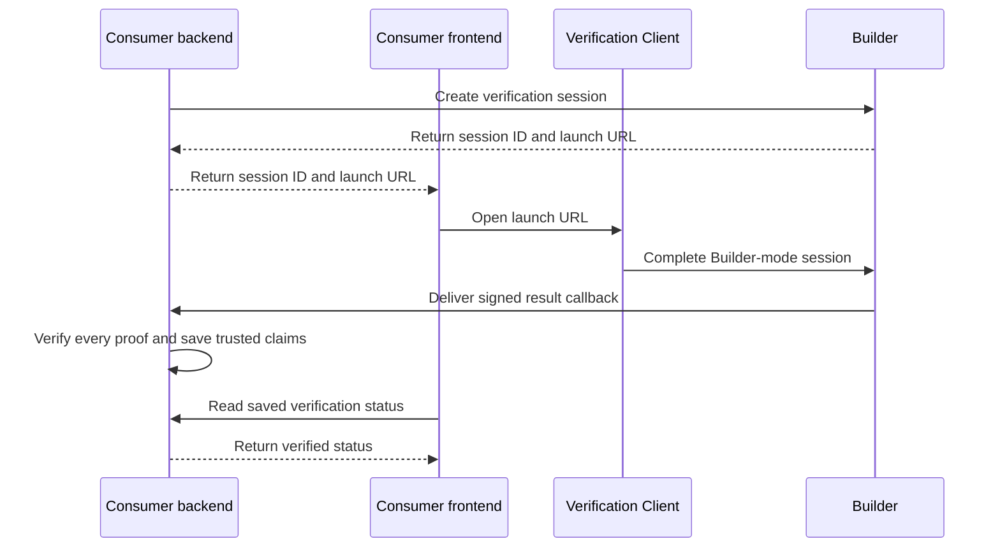

# @reclaimprotocol/client

Use this typed HTTP client and SDK to request verifications and verify **data
points** about your users, such as a follower count, an account balance, or an
order. Integrate it directly into your app.

One package gives you:

- **`ReclaimVerification.create(...)`** — create verification sessions and
  receive and verify results.
- **`ReclaimClient`** — call any operation in the spec with the low-level typed
  HTTP client (`call('OperationId', args)`).
- **Crypto helpers** — decrypt ECIES results with the organization's ETH key,
  verify Builder-signed result JWSs, discover JWKS keys, and verify exact
  proofs. Result signing is Builder-managed in `api=2`.

Use the API-only entry point in browsers and edge runtimes. Use the package
root in trusted runtimes that need proof verification, signing, or encryption.

## Contents

- [Choose an entry point](#choose-an-entry-point)
- [The model in one paragraph](#the-model-in-one-paragraph)
- [Install](#install)
- [Quick start](#quick-start-consumer)
- [API reference](#api-reference)
- [Crypto and key helpers](#crypto-and-key-helpers)
- [`ReclaimClient` low-level API](#reclaimclient-low-level)
- [Email proofs](#email-proofs)
- [Security notes](#security-notes)

## Choose an entry point

Use the narrowest entry point that fits the code:

| Import | Use it for | Includes |
| --- | --- | --- |
| `@reclaimprotocol/client/api` | Browser Verification Clients, frontend dashboards, agents, and backend API calls | Browser-safe `fetch` transport plus OpenAPI-generated operation and schema types |
| `@reclaimprotocol/client` | Consumer backends and other trusted runtimes | API client, session workflows, result verification, proof verification, legacy signing, and encryption |
| `@reclaimprotocol/client/openapi` | Type-only integrations | OpenAPI-generated types only |
| `@reclaimprotocol/client/email` | Consumer backends that verify email proofs | `verifyEmailProof` and its types. See [Email proofs](#email-proofs) |
| `@reclaimprotocol/client/email/*` | Reclaim Portal and the AI SDK | The email verification core: `core`, `protocol`, `contracts`, `schemas`, `sender`, `google`, `preview`, and `ai` |

Both runtime entry points export the exact same `ReclaimClient`,
`ReclaimClientOptions`, `ProblemError`, and OpenAPI-generated types. The package
root re-exports `/api` and adds the trusted-runtime SDK features. It doesn't
define another API client or another problem-error type.

The `/api` dependency graph doesn't include proof, attestor, signing,
encryption, or Node-only modules. The shared client doesn't set `User-Agent`,
which browsers don't allow JavaScript to control. Pass an identifying header
explicitly from a runtime that permits it.

```ts
import {
  isProblemError,
  ReclaimClient,
} from '@reclaimprotocol/client/api'

const builder = new ReclaimClient({
  baseUrl: 'https://build.reclaimprotocol.org',
  // Use a bearer token for consumer or administrative API calls.
  token,
})

try {
  const { data: session } = await builder.call('GetVerificationSession', {
    params: { sessionId },
  })
  console.log(session.status)
} catch (error) {
  if (isProblemError(error)) {
    console.error(error.output.statusCode, error.data.title)
  }
}
```

`ProblemError` stores the RFC 9457 document in `error.data`. It is
Boom-compatible: `@hapi/boom`'s `isBoom(error)` returns `true`, and
`error.output.statusCode` contains the HTTP status. The API entry point creates
this shape without importing the Boom runtime into browser bundles.

A registered Verification Client uses its session-bound UUID to call the
bootstrap endpoint:

```ts
import { ReclaimClient } from '@reclaimprotocol/client/api'

const builder = new ReclaimClient({
  baseUrl: builderApiUrl,
  headers: { 'x-reclaim-vc-id': verificationClientId },
})

const { data: bootstrap } = await builder.call('BootstrapVerificationClient', {
  params: { sessionId },
})
```

Builder also returns an immutable, session-scoped feature configuration on
`VerificationSession.runtimeConfig`. Read only keys the Verification Client
implements, and use a safe fallback because older sessions can omit the
snapshot:

```ts
import {
  getBooleanFeatureFlag,
  ReclaimClient,
} from '@reclaimprotocol/client/api'

const { data: bootstrap } = await builder.call('BootstrapVerificationClient', {
  params: { sessionId },
})
const useNewPicker = getBooleanFeatureFlag(
  bootstrap.session.runtimeConfig,
  'portal.newRequestPicker',
  false,
)
```

The `/api` and package-root entry points export the same browser-safe flag
readers. Verification Clients never call the admin feature-flag endpoints or
fetch live values during a session. See
[Verification Client feature flags](https://build.reclaimprotocol.org/docs).

Treat the Verification Client ID as deployment configuration, not as proof of
identity. Builder requires it to match the client assigned to the session, but
the public UUID doesn't authenticate the caller. Never put an organization
secret, result-signing private key, or proof-owner private key in browser code.
Builder owns result signing in Builder mode; claimant-facing Verification
Clients receive no signing key. Call `verifyResultFull` from the consumer
backend after receiving a result.

## The model in one paragraph

Authentication uses one **per-organization secret** (`rorg_…`, the
`orgSecret`) as a bearer credential; it uses no signatures or per-call
secrets. An **Ethereum (secp256k1) public key** identifies the organization.
When `canEncryptResult` is enabled, verification **results are encrypted with
ECIES** (secp256k1 + AES-256-GCM) to the organization's ETH public key. Keep the
matching **ETH private key** (`0x`-hex, the form any wallet or ethers emits) to
decrypt. Builder signs the result JWS with its managed `ES256K` key; verify it
against the Builder's trusted issuer and well-known JWKS.

```
                          ┌─ one-time setup ─────────────────────────┐
  Configure callback in dashboard or raw API       ← where results go
  SetOrgKeypair via dashboard or raw API            ← optional encryption
                          └──────────────────────────────────────────┘
                          ┌─ per verification ───────────────────────┐
  reclaim.sessions.create(...) → open session.verificationUrl
        … end-user completes it …
  POST → your callbackUrl → reclaim.results.receive(body) → verified payload
                          └──────────────────────────────────────────┘
```

## Install

```bash
npm install @reclaimprotocol/client
```

## Quick start (consumer)

Configure the client once with your organization secret. In the example,
`orgId` identifies the organization that owns the secret.

```ts
import { ReclaimVerification } from '@reclaimprotocol/client'

const reclaim = ReclaimVerification.create({
  orgSecret: process.env.RECLAIM_ORG_SECRET!,  // rorg_… (issued by an org owner)
})
const orgId = process.env.RECLAIM_ORG_ID!      // your org's id
```

### 1. Register a callback (one-time)

Register the endpoint where Builder posts verification results. Complete this
one-time setup with the **dashboard** or the **agent** too; see [Three ways to
set up](#three-ways-to-set-up).

The high-level verification client intentionally excludes callback management.
Use the dashboard, the MCP `create_org_callback_subscription` tool, or call the
generated `CreateOrgCallbackSubscription` operation with a human-authenticated
`ReclaimClient` when automating organization setup. The consumer `orgSecret`
does not authenticate this management operation.

### 2. Enable encryption (optional, one-time)

By default, the Builder delivers plaintext signed JWSs. To have it **encrypt**
results so only you can read them, register your organization's ETH **public**
key with `canEncryptResult: true`. Use any ETH key (the `0x`-hex form wallets
and ethers emit), or mint one with the SDK:

```ts
import { generateEthKeypair } from '@reclaimprotocol/client'
// keep privateKeyHex secret — it decrypts results
const { privateKeyHex, publicKeyHex } = generateEthKeypair()
```

```ts
// (also doable from the dashboard, which can mint the keypair in-browser)
await reclaim.api('SetOrgKeypair', {
  params: { orgId },
  body: {
    publicKey: publicKeyHex,
    canEncryptResult: true,
  },
})
```

### 3. Create a session (per verification)

```ts
const session = await reclaim.sessions.create({
  providers: [{ providerId: 'prov_…' }],   // one or more, proved in order → one combined result
  context: { userId: 'abc' },
  // Optional: snapshot this active organization theme onto the session.
  themeId: '550e8400-e29b-41d4-a716-446655440000',
  // Optional: derive and bind the legacy TEE nonce locally after creation.
  orgEthPrivateKey,
})
console.log('open this:', session.verificationUrl)   // hand to the end-user
```

#### Choose a verification client

`sessions.create` always creates a Builder v2 session. Select the claimant-facing
Verification Client with its registered base URL:

```ts
import { VerificationClient } from '@reclaimprotocol/client'

const session = await reclaim.sessions.create({
  providers: [
    // Blank/omitted → latest; 1.2.2 → exact; ^1.2.2 → >=1.2.2 <2.0.0.
    { providerId: 'prov_…', version: '^1.2.0' },
  ],
  context: { userId: 'abc', orderId: 'order-123' },
  verificationClientUrl: VerificationClient.portals,
})

// Builder resolves the URL to a registered client, pins its UUID on the
// session, and adds the session id plus api=2. Share this returned URL.
console.log(session.verificationUrl)
```

Builder resolves each provider independently and returns its exact
`resolvedVersion`. Verification Clients execute that resolved recipe; they
don't resolve versions themselves.

For imported legacy providers, pass consumer values in `context`. Builder-mode
clients support `{{context.key}}`, then `{{context_key}}`, then `{{key}}` as
compatibility aliases. Explicit request or provider-script parameters take
precedence.

Builder snapshots the selected theme at session creation. Omit `themeId` to use
the organization's most recently updated active theme. If the organization has
no active theme, the Verification Client uses its default presentation. A
theme's optional localized `consent` block controls whether the claimant sees a
consent screen before the first provider starts.

For a deliberate troubleshooting session, append `diag=1` to the returned URL
before opening it:

```ts
const verificationUrl = new URL(session.verificationUrl)
verificationUrl.searchParams.set('diag', '1')
window.location.assign(verificationUrl)
```

`diag=1` is honored only with Builder mode's existing `api=2` selector. It can
enable logs containing personal data, so don't add it to normal production
links. Redirect parameters are also client-owned: append them to the returned
URL instead of putting them in the session request.

Use `{{context.key}}` in new Builder recipes for values supplied in `context`;
Builder validates those through the provider's `requiredContext`. Imported
recipes can fall back to `{{context_key}}` and then `{{key}}`. A lower-priority
alias is used only when the recipe doesn't use a higher-priority spelling, and
an explicit parameter always wins. Clients apply this to URLs, headers, request
bodies, response matches, response redactions, provider scripts, and
interceptor-created claims. This applies only to `api=2`; it doesn't change
legacy sessions. Builder-owned
`reclaimSessionId` and `attestationNonce` remain context-only.

The value must exactly equal that deployment's registered
`verification_clients.uri`, including its scheme, host, path, trailing slash,
query, and optional `{sessionId}` placeholder. Do not substitute the placeholder
yourself. Builder either substitutes it or adds a `sessionId` query parameter,
then adds `api=2`. An unregistered or slightly different URL is rejected with
HTTP 400.

The SDK exposes declarative URLs for these intended uses.
Builder owns terminal-result signing and encryption; claimant-facing clients
receive no signing key, issuer, JWKS URL, or callback key:

| Registry name | Builder v2 use |
| --- | --- |
| `builder` | Builder's hosted claimant page at `/v/{sessionId}`. |
| `portals` | Interactive web portal. The default when you omit the URL. |
| `verifier-app` | Reclaim Verifier mobile app identifier. |
| `inapp-sdk` | In-app SDK or add-to-app module identifier. |
| `reclaim-browser-extension` | Browser extension identifier. |
| `zkfetch` | Programmatic client in the separate `ZKFETCH` quota pool. |

Use `VerificationClient` to select a built-in client or supply a registered
custom URL:

```ts
VerificationClient.builder
VerificationClient.portals
VerificationClient.verifierApp
VerificationClient.inAppSdk
VerificationClient.reclaimBrowserExtension
VerificationClient.zkFetch
VerificationClient.custom('https://verify.example.com')
```

Administrators can also register additional clients with their own URL.

Examples for the currently supported interactive clients:

```ts
import { VerificationClient } from '@reclaimprotocol/client'

// 1. Default (Portal) — omit verificationClientUrl.
const byDefault = await reclaim.sessions.create({
  providers: [{ providerId }],
  context,
})

// 2. Portal, selected explicitly.
const portal = await reclaim.sessions.create({
  providers: [{ providerId }],
  context,
  verificationClientUrl: VerificationClient.portals,
})

// 3. Reclaim Verifier app.
const verifierApp = await reclaim.sessions.create({
  providers: [{ providerId }],
  context,
  verificationClientUrl: VerificationClient.verifierApp,
})

// 4. In-app SDK or add-to-app host. Required for these apps: pass
//    inApp.verificationUrl to the app's startVerificationFromUrl.
const inApp = await reclaim.sessions.create({
  providers: [{ providerId }],
  context,
  verificationClientUrl: VerificationClient.inAppSdk,
})

// 5. Browser extension.
const browserExtension = await reclaim.sessions.create({
  providers: [{ providerId }],
  context,
  verificationClientUrl: VerificationClient.reclaimBrowserExtension,
})

// 6. Builder's hosted claimant page.
const hosted = await reclaim.sessions.create({
  providers: [{ providerId }],
  context,
  verificationClientUrl: VerificationClient.builder,
})

// 7. Separately registered client or another Builder deployment.
const custom = await reclaim.sessions.create({
  providers: [{ providerId }],
  context,
  verificationClientUrl: VerificationClient.custom(
    'https://verify.example.com',
  ),
})
```

A session works only in the client it was created for. Builder fixes the
session's client at creation, and every Verification Client request must carry
that client's `x-reclaim-vc-id`, or it gets
`403 x-reclaim-vc-id does not match this session`. Opening the link in another
client first doesn't change this. So a mobile app using the in-app SDK or the
add-to-app module needs sessions created with `VerificationClient.inAppSdk`
(`https://build.reclaimprotocol.org/share/inapp-sdk`). A session created
without `verificationClientUrl` is a Portal session, and those apps can't open
it.

Those apps start Builder mode from either value of the response:
- `startVerificationFromUrl(inApp.verificationUrl)`;
- `startVerificationFromJson({ api: '2', sessionId: inApp.id })`.
  Add `diag: '1'` only when `verificationUrl` contains `diag=1`. Other keys
  are ignored, and the Builder URL comes from the app's configuration.

The Consumer supplies a URL, not `verificationClientId` or
`x-reclaim-vc-id`. Builder resolves and stores the UUID. The selected
Verification Client reads its own configured UUID and sends it only on its
session-bound Builder requests.

To add client-owned redirect data, modify only the returned URL after session
creation:

```ts
const claimantUrl = new URL(portal.verificationUrl)
claimantUrl.searchParams.set(
  'redirectUrl',
  'https://merchant.example/verification-complete',
)
// `redirectUrl` is a portal convention. Another client can use another name.
openForClaimant(claimantUrl.toString())
```

Do not replace `api` or `sessionId`. Builder doesn't store or execute these
redirect values, and callbacks remain organization-scoped subscriptions rather
than per-session request fields.

#### Complete web application flow

Keep session creation and result verification on your backend. Give the
frontend only the returned launch URL. Treat a client redirect as navigation,
not as evidence that verification succeeded.



**1. Create the request on your backend.** Keep `RECLAIM_ORG_SECRET` private
and save the returned session ID with your user or order. The session opens in
the Portal unless you pass a `VerificationClient` URL.

```ts
import {
  type CallbackBody,
  ReclaimVerification,
} from '@reclaimprotocol/client'

const reclaim = ReclaimVerification.create({
  orgSecret: process.env.RECLAIM_ORG_SECRET!,
})

async function createVerificationRequest(
  userId: string,
) {
  const session = await reclaim.sessions.create({
    providers: [{ providerId: 'prov_…', version: '^1.2.0' }],
    context: { userId },
  })
  await savePendingVerification({
    sessionId: session.id,
    userId,
    orgId: session.orgId,
  })
  return { sessionId: session.id, verificationUrl: session.verificationUrl }
}
```

**2. Launch it from your frontend.** Open exactly the returned URL. Builder has
already added `sessionId` and `api=2`. You may append a redirect parameter that
the selected Verification Client supports, but don't replace either Builder
parameter.

```ts
const response = await fetch('/api/verifications', {
  method: 'POST',
  headers: { 'content-type': 'application/json' },
  body: JSON.stringify({ client: 'portals' }),
})
const { sessionId, verificationUrl } = await response.json()

const claimantUrl = new URL(verificationUrl)
claimantUrl.searchParams.set(
  'redirectUrl',
  `${location.origin}/verification-returned?sessionId=${encodeURIComponent(sessionId)}`,
)
location.assign(claimantUrl.toString())
```

On the return page, ask your backend for the saved session status. Don't read a
proof or trusted claim from the redirect URL.

**3. Receive and verify on your backend.** Register a terminal callback once.
The `{{sessionId}}` placeholder is filled from Builder's session record and URL
encoded. Persist the delivery before returning a successful HTTP status so a
process crash can't lose it.

```ts
// One-time setup as the signed-in organization member, not with orgSecret.
import { ReclaimClient } from '@reclaimprotocol/client/api'
const setupClient = new ReclaimClient({ token: humanAccessToken })
await setupClient.call('CreateOrgCallbackSubscription', {
  params: { orgId },
  body: {
    callbackUrl: 'https://my.app/reclaim/callback/{{sessionId}}',
    events: [
      'verification_success',
      'verification_rejected',
      'verification_error',
      'verification_cancelled',
      'session_expired',
    ],
  },
})

// HTTP callback handler. `sessionId` comes from the route path.
async function acceptCallback(sessionId: string, requestBody: CallbackBody) {
  const deliveryId = await saveCallbackDelivery({ sessionId, requestBody })
  await enqueueCallbackVerification(deliveryId)
  return new Response(null, { status: 202 })
}
```

Verify the durable delivery in a backend worker. Load the expected session and
organization from your database; don't take either expected value from the
callback payload. `results.receive` decrypts when needed, validates the
Builder issuer and JWKS, verifies the outer result JWS,
checks the session/audience and any legacy result expiry, and runs the package's
`verifyRequestProof` checks for every proof.

```ts
async function verifyCallbackDelivery(deliveryId: string) {
  const delivery = await loadCallbackDelivery(deliveryId)
  const expected = await loadPendingVerification(delivery.sessionId)
  const outcome = await reclaim.results.receive(delivery.requestBody, {
    orgEthPrivateKey: process.env.RECLAIM_ETH_PRIVATE_KEY,
    reclaimSessionId: expected.sessionId,
    expectedAud: expected.orgId,
  })

  if (outcome.kind !== 'result') return // optional progress subscription

  const trustedClaims = outcome.result.proofs?.flatMap((proof) => (
    proof.data ? [proof.data] : []
  )) ?? []
  await markVerificationComplete({
    sessionId: expected.sessionId,
    trustedClaims,
  })
}
```

`results.receive` throws `ResultVerificationError` for an invalid signature,
issuer, audience, session binding, legacy result expiry, proof signature, proof hash, TEE, or
attestor trust check. Mark a verification complete only after this call
succeeds. Make callback storage idempotent because Builder can retry delivery.

Removing `api=2` does not turn this request into a valid legacy request. To
create a legacy verification, continue using the legacy JS SDK/backend request
format. URLs without `api=2` stay on each client's unchanged legacy parser.

With `orgEthPrivateKey`, the SDK creates the session, derives the selected exact
legacy nonce, signs the Builder binding with
EIP-191, and registers it at
`PUT /verifications/sessions/{sessionId}/tee-nonce`. The private key is never
sent to Builder. The binding is idempotent for identical values and immutable
afterward; bind before proof generation starts. The default `nonceMode: 'hash'`
uses `RECLAIM_TEE_NONCE_V1`. Set `nonceMode: 'signature'` for the older
65-byte EIP-191 nonce that legacy `verifyProof` also accepts. Use
`teeNonceMode: 'signature'` on `sessions.create` for this compatibility mode.

Because this endpoint is an authenticated POST, you can use `curl` without the
SDK. The organization secret is the only credential:

```bash
curl -X POST "$BUILDER_URL/verifications/sessions" \
  -H "Authorization: Bearer $RECLAIM_ORG_SECRET" \
  -H 'Content-Type: application/json' \
  -d '{
        "providers": [{ "providerId": "prov_…" }],
        "context": { "userId": "abc" },
        "verificationClientUrl": "https://your.app/"
      }'
# → 201 { "id": "…", "verificationUrl": "…&api=2", "status": "pending", "mode": "…", … }
```

For the in-app SDK or add-to-app module, send
`"verificationClientUrl": "https://build.reclaimprotocol.org/share/inapp-sdk"`.
Those apps can't open a session created for another client.

For a TEE-bound session, a raw HTTP client must derive the legacy hash nonce
with its organization verification private key, sign the exact
`RECLAIM_BUILDER_TEE_BINDING_V1:{organizationId}:{sessionId}:{applicationId}:{timestamp}:{attestationVersion}:{attestationNonce}`
payload with EIP-191, then call
`PUT /verifications/sessions/{sessionId}/tee-nonce` with the same `OrgToken`.
Never send the private key in either request.

### 4. Receive and verify the result

When the user finishes, Builder sends a POST request to your `callbackUrl`.
Pass the request body to `results.receive`. It decrypts encrypted results,
verifies the outer signature, and verifies every exact proof. It
**throws if the result is invalid**, so reaching the `result` branch means the
result is verified.

```ts
// Load these expected values from your database, not from the callback body.
const expected = await loadPendingVerification(callbackRouteSessionId)
const outcome = await reclaim.results.receive(requestBody, {
  orgEthPrivateKey: process.env.RECLAIM_ETH_PRIVATE_KEY,
  reclaimSessionId: expected.sessionId,
  expectedAud: expected.orgId,
})
if (outcome.kind === 'result') {
  // These values came from verifyRequestProof. Don't trust diagnostic copies from
  // the outer payload for application decisions.
  const trustedClaims = outcome.result.proofs?.flatMap((proof) => (
    proof.data ? [proof.data] : []
  )) ?? []
  useVerifiedClaims(trustedClaims)
} else {
  console.log('progress event:', outcome.event)          // non-terminal notification
}
```

### Three ways to set up

Choose any of these one-time setup methods; each uses the same API:

- **Raw OpenAPI client** — use a human-authenticated `ReclaimClient` for
  `CreateOrgCallbackSubscription`. Use `SetOrgKeypair` through `reclaim.api`
  when configuring result encryption, which is useful for scripting or CI.
- **The dashboard** — the organization's web console has a callback-subscription form and a "Set encryption keypair" dialog that can **generate the ETH keypair in your browser** and download the private key for you.
- **The agent** (`@reclaimprotocol/agent` — the `reclaim` CLI / MCP server) — handy while building and testing a provider locally.

At runtime, your backend needs only the organization secret for
authentication and the ETH private key for decryption. The
`results.receive(...)` step is unchanged.

---

## API reference

### `ReclaimVerification.create(config)`

Call `ReclaimVerification.create(config)` to return a client with `sessions`
and `results` namespaces, plus an `api` escape hatch.

| `ReclaimConfig` field | type | required | notes |
|---|---|---|---|
| `orgSecret` | `string` | **yes** | The org secret `rorg_…`. Sent as `Authorization: Bearer`; identifies the org server-side. |
| `baseUrl` | `string` | no | Defaults to the production Builder. |
| `fetch` | `typeof fetch` | no | Custom fetch (tests, edge runtimes). |
| `headers` | `Record<string,string>` | no | Extra headers merged into every request. |

`orgSecret` is the only required configuration value. Pass the optional ETH
private key directly to `sessions.create`, `results.receive`, or
`results.decrypt`. The SDK doesn't cache or serialize that key.

Use `reclaim.export()` to serialize non-secret configuration. Restore it with
runtime credentials:

```ts
const saved = reclaim.export()
const restored = ReclaimVerification.import(saved, { orgSecret })
```

The JSON contains only a format version and Builder base URL. It never contains
the organization secret, ETH private key, headers, or custom `fetch` function.

### Verification clients

```ts
import { VerificationClient } from '@reclaimprotocol/client'
```

- `VerificationClient.builder`, `.portals`, `.verifierApp`, `.inAppSdk`,
  `.reclaimBrowserExtension`, and `.zkFetch` contain production URLs.
- `VerificationClient.custom(uri)` returns a separately registered client URL
  unchanged.

The helper doesn't make a URL trusted or register it in Builder. Your backend
chooses an already registered URL, and
`sessions.create({ verificationClientUrl })` asks Builder to resolve that URL
to its registered client UUID. Omit the URL to select `portals`.

### `reclaim.sessions`

```ts
reclaim.sessions.create({ providers, context, verificationClientUrl?, orgEthPrivateKey? })
  // providers: { providerId, version? }[] — proved in order, one combined result; all required.
  // → VerificationSession (has `id`, `verificationUrl`, `status`, `mode`, …)
  // verificationClientUrl selects a registered Verification Client by URL;
  // omitted, it defaults to the Portal. The session then only opens in that
  // client: use VerificationClient.inAppSdk for in-app SDK / add-to-app hosts.
  // orgEthPrivateKey optionally creates the post-create TEE binding locally.
  // The returned verificationUrl contains sessionId and api=2.
reclaim.sessions.bindTeeNonce(reclaimSessionId, { orgEthPrivateKey, timestamp? })
  // Explicit two-step/retry form. Reads the session, derives locally, and binds.
reclaim.sessions.get(reclaimSessionId)         // → VerificationSession
reclaim.sessions.listEvents(reclaimSessionId)  // → VerificationEventRecord[]
```

The Builder resolves `verificationClientUrl` to the session's registered
`verificationClientId`. It does not accept a per-session callback or redirect
URL. After creation, the consumer may append redirect query parameters that
the selected Verification Client understands; the Builder does not interpret
or execute them. A URL without `api=2` is handled by the selected client's
legacy path.

### `reclaim.results`

```ts
reclaim.results.receive(body, opts?)        // → ReceivedDelivery  ← the 90% path
reclaim.results.decrypt(body, orgEthPrivateKey?) // → Jws
reclaim.results.verify(jws, opts?)          // → VerifyResultFullOutcome
```

Each verified `result.proofs` entry includes the exact `proof` received
from the Verification Client, its provider and request identity, all attestor
addresses, derived proof hashes, trusted `data`, unverified `publicData`, and
the claimant/session and attestor TEE verification outcomes. This preserves the
complete proof for storage or on-chain use while keeping trusted
extracted parameters separate from unverified convenience data.

`receive` branches on the delivery:

```ts
type ReceivedDelivery =
  | { kind: 'result'; result: VerifyResultFullOutcome }  // signed, decrypted, verified result
  | { kind: 'event'; event: VerificationEvent; eventData: Record<string, unknown> } // plaintext lifecycle event
```

`ReceiveOptions` includes the `reclaimSessionId` check, `expectedAud`, trusted
issuer configuration, attestor allowlists, and an optional
`orgEthPrivateKey`. The private key decrypts encrypted results and verifies TEE
proof binding. All three methods are async.

`verifyResultFull` is the recommended server-side API. Configure the canonical
Builder issuer and well-known JWKS URL (or keep those values in your own
server-side trust configuration):

```ts
await reclaim.results.verify(jws, {
  reclaimSessionId: session.id,
  expectedAud: orgId,
  trustedIssuers: ['https://build.reclaimprotocol.org'],
  jwksUrl: 'https://build.reclaimprotocol.org/.well-known/jwks.json',
})
```

The SDK compares the signed header `iss` with that trusted set before it
fetches JWKS. It never uses an untrusted `iss` as a network destination. Keep
issuer resolution server-side and treat a missing or changed issuer as a
verification failure.

Issuer trust and key discovery are separate Builder deployment inputs. Do not
construct the JWKS URL from the JWS payload.

`verifyResultFull` calls this package's `verifyRequestProof`
implementation for every exact `Proof` object in the signed result. It does
not base64-decode, wrap, reconstruct, or otherwise transform those proofs.
When you provide `reclaimSessionId`, every proof must
also contain that session ID. This prevents a valid proof from an older session
from being placed in a newly signed result envelope. For an older deployment
that produced unbound proofs, set `proofValidation.requireSessionBinding` to
`false` explicitly during its migration. A different embedded session ID is
always rejected.
By default, it uses each result's
`provider_id` and exact `resolved_version` to resolve the provider hash
requirements. You can instead pass `hashes`, `proofValidation`, or
`proofValidationByProviderId`. These options mirror `verifyRequestProof`,
including `hasNoPii`, verifier TEE (`teeAttestation.appSecret`), and
attestor-TEE checks. The configured Builder JWKS URL supplies the
purpose-bound result keys, its `x-reclaim-attestors` signer list, and its
`x-reclaim-attestor-image-digests` Confidential Space image allowlist. When
the JWKS publishes image digests, `verifyResultFull` verifies any attestor TEE
`claimAttestation` a witness carries — its attestor address and claim
signature, and its `attestation_report` pinned to those digests when present.
Neither is required: like `@reclaimprotocol/js-sdk`, a witness is trusted by
its signer being in `x-reclaim-attestors`. A portal TEE proof without a bound
nonce has no `claimAttestation`, and production attestors sign without
returning a report. When nothing was attested,
`isAttestorTeeAttestationVerified` comes back `false`. Set
`proofValidation.attestorTeeAttestation` to require a `claimAttestation` on
every witness. If its `expectedImageDigests` is also set, the SDK uses the
intersection: caller policy can narrow the published trust list, but can't
broaden it. TEE settings preserve the same configuration objects;
`verifyResultFull` does not accept injected verification hooks. The surrounding
issuer, session, and context checks are stateless; persist accepted session IDs
in your application to prevent replay.

For proof-hash comparison only, the verifier canonicalizes the equivalent
redaction transport spellings `oprf`, `oprf-mpc`, and `oprf-raw` to `_oprf`.
This keeps extension-produced proofs compatible without changing the proof,
its signed claim parameters, or the redaction mode used to create it.

New Builder result JWS payloads don't contain `exp`; a verified callback is a
durable result. Older Builder payloads can still contain `exp`. Those payloads
use the producer-selected Unix timestamp and fail after that time by default.
Set `ignoreExpiration: true` only when intentionally accepting a stored legacy
result after its signed deadline. This option doesn't bypass Builder Session
expiry, issuer trust, session binding, proof verification, or application-level
replay prevention.

An AI-session result can also carry email proofs. Each email entry in
`results[].requests[]` has `method: 'email'`, an `email-v1` proof, and
`email: { provider, sender, dkimSigner, request }`. `verifyResultFull` verifies
it with [`verifyEmailProof`](#email-proofs) against the entry's `request`, and
the outcome includes `method: 'email'`, `emailProvider`, `sender`,
`dkimSigner`, `authenticatedAddress`, `extractedParameters`, and `emailCheck`.
Two options control it:

- `emailVerification`: `'signature'` (default) or `'full'`. See
  [Email proofs](#email-proofs) for what each mode checks.
- `emailIssuers`: Reclaim Portal signer addresses that you trust, in addition
  to the `x-reclaim-email-issuers` list in Builder's JWKS. A malformed
  address throws a 400 error instead of failing the result.
- `allowEmailProofs`: `hashes`, `proofRecipes`, and
  `proofValidation.hashes`/`providerId` pin which Reclaim proofs you accept,
  and they can't describe an email proof. When you set any of them, an email
  entry fails with `email-not-allowed` unless you also set
  `allowEmailProofs: true`.

An email entry must carry its `email.request`, and its `email.provider`,
`email.sender`, and `email.dkimSigner` must match the verified proof;
otherwise it fails with `email-proof-invalid`.

A failed email entry makes the result fail with `invalid-proof`, and the
entry's `reason` is `email-issuer-not-trusted`, `email-proof-invalid`,
`email-not-allowed`, or `email-full-verification-unavailable`. Only
`email-full-verification-unavailable` makes the error `retryable`, because a
redelivery can succeed after you fix the host.

Email proofs expire one hour after Portal issues them. Builder verifies each
proof before it signs the result, so `verifyResultFull` checks email proof
expiry at the result's signed `iat`, and a stored or redelivered result stays
verifiable. Pass `now` to check at another time. `full` mode re-checks DKIM
against current DNS, so it can fail later if the sender rotates its key.

The result's `extracted_parameters` and `content_hash` fields are signed
diagnostics. Use the verified data returned for each proof in
`result.proofs[].data`; do not trust the diagnostic copies for an authorization
decision.

**Invalid results throw.** `receive` and `verify` (and the underlying
`verifyResult` / `verifyResultFull`) never *return* a failed verdict. They throw
a **`ResultVerificationError`** carrying the failure `reason` and the full
`outcome` (payload, `reclaimSessionId`, per-proof detail). The `result` branch
is therefore always verified; wrap the call to inspect failures:

```ts
import { ResultVerificationError } from '@reclaimprotocol/client'
try {
  const { result } = await reclaim.results.receive(body, {
    orgEthPrivateKey,
    reclaimSessionId,
  })
  // result.payload is verified
} catch (err) {
  if (err instanceof ResultVerificationError) {
    console.error(err.reason, err.outcome)  // 'expired', 'bad-signature', 'invalid-proof', …
  } else {
    throw err
  }
}
```

A non-terminal `event` delivery is not a result and never throws. It returns
`{ kind: 'event', … }`.

#### Respond to a callback delivery

Builder retries a delivery until your callback route answers 2xx, and a
delivery that never succeeds holds back that session's later events. If
retrying the same body can't help, answer 2xx. If the failure is temporary,
answer 5xx.

`ResultVerificationError.retryable` tells you which case you're in. It's
`true` only when a temporary condition caused the failure:
Builder's JWKS or provider recipe couldn't be fetched because of a network
error, a timeout, an HTTP 5xx, or rate limiting (`jwks-fetch-failed`,
`session-resolution-failed`, or an `invalid-proof` whose proofs all failed
this way). It's `false` for everything about the result itself, including
`bad-signature`, `issuer-not-trusted`, `aud-mismatch`,
`reclaimSessionId-mismatch`, `expired`, and an `invalid-proof` with any
genuinely invalid proof.

```ts
app.post('/reclaim/callback', async (req, res) => {
  try {
    const { result } = await reclaim.results.receive(req.body, {
      orgEthPrivateKey,
      reclaimSessionId,
    })
    await markVerificationComplete(result)
    res.sendStatus(200)
  } catch (err) {
    if (err instanceof ResultVerificationError) {
      await storeFailure(err.reason, err.outcome)
      // Retrying a bad result can't help, so only ask for a retry when the
      // failure is temporary.
      res.sendStatus(err.retryable ? 503 : 200)
      return
    }
    throw err
  }
})
```

`results.receive` can also throw an ordinary `Error` instead of
`ResultVerificationError`, for example when `orgEthPrivateKey` is missing or
doesn't match the key the result was encrypted to. Treat it as a
configuration problem: log it and answer 5xx, so the delivery succeeds once
you fix the key. Builder holds an undelivered result for 7 days.

### `reclaim.api` — escape hatch

```ts
// fully typed against the OpenAPI spec — for any operation the namespaces don't wrap
const { data } = await reclaim.api('GetVerificationSession', { params: { sessionId } })
```

## Crypto and key helpers

```ts
// Eth encryption keys (consumer side)
generateEthKeypair(): { privateKeyHex, publicKeyHex, publicJwk, ethAddress }  // mint an org keypair
loadDecryptionKey(hex): DecryptionKey            // 0x-hex eth private key → raw scalar
uncompressedPubkeyToJwk(hex): Jwk                // 0x04+128 hex → secp256k1 JWK
pubkeyJwkToEthAddress(jwk): string               // secp256k1 JWK → 0x eth address

// ECIES (Builder encrypts terminal results; consumers only decrypt)
encryptForEthPublicKey(publicJwk, bytes): Promise<string>  // → ECIES ciphertext (base64url)
decryptCallback(decryptionKey, body): Promise<Jws>          // ECIES/plaintext → JWS

// Result JWS (Builder-managed ES256K)
verifyResult(jws, opts): VerifyResultOutcome                   // offline signature/nonce check (throws if invalid)
verifyResultFull(jws, opts): Promise<VerifyResultFullOutcome>  // + JWKS discovery + exact proof verification (throws if invalid)
verifyJwsSignature(jws, signerPublicKey), decodeJwsPayload(jws)

// JWKS (signature-key discovery)
fetchJwks(url), selectKey(...), jwkToUncompressedPublicKey(jwk)

// Legacy compatibility helper. verifyResultFull does not use an inner proof JWS.
verifyNestedProof(...): NestedProofOutcome
```

### ETH keypair utilities (low-level)

`generateKeypair()`, `deriveFromPrivateKey(hex)`, `addressFromPublicKey(...)`,
plus the `secp` instance and `addressFromUncompressedPubkey(...)`, are exported
for the Verification Client and the agent (proof-owner signing). A consumer
that enables encryption holds an **ETH private key** (the same key family) to
decrypt; see the encryption-key helpers above. `canonicalJson` (RFC 8785) is
also exported for interoperable diagnostic hashes.

## `ReclaimClient` (low-level)

```ts
import { ReclaimClient } from '@reclaimprotocol/client'
const client = new ReclaimClient({ baseUrl, token, fetch, headers })
const { data, response } = await client.call('GetVerificationSession', { params: { sessionId } })
```

Errors are thrown as the same Boom-compatible `ProblemError` exported by
`@reclaimprotocol/client/api`. `throwProblemError`, `DEFAULT_BASE_URL`,
`USER_AGENT`, and encoding helpers (`b64url`, `base64urlToBytes`, `bytesToHex`,
`hexToBytes`) are also exported. The `call` method is fully typed against the
generated OpenAPI operations.

## Email proofs

Reclaim Portal issues an `email-v1` proof when a user shares an email from
their mailbox. Verify it on your backend with `verifyEmailProof`:

```ts
import { verifyEmailProof } from '@reclaimprotocol/client/email'

const outcome = await verifyEmailProof(proof, {
  trustedIssuers: ['0xPortalSignerAddress'],
  request, // the EmailRequest the proof answers
})
console.log(outcome.authenticatedAddress, outcome.extractedParameters)
```

The email entry points are server-only and need Node.js 22.19 or later.
Neither the package root nor `/api` loads them; `verifyResultFull` loads
`/email` only when a result contains an email proof.

`verifyEmailProof` has two modes:

- **`signature`** (default) checks that the proof's identifier matches its
  canonical parameters and context, that the EIP-191 signature recovers to the
  proof's issuer, and that the issuer is in `trustedIssuers`. It checks that the
  signed digest matches the email proof, that the raw email matches its digest,
  that the extracted values match the signed context, and that the proof hasn't
  expired at `now` (default: the current time). Each `trustedIssuers` entry
  must be `0x` and 40 hex digits; a malformed one throws a 400 error. When you
  pass `request`, it also checks the app, owner, session,
  nonce, request hash, sender, provider, context, and issue time against it.
  This mode needs only the package's regular dependencies.
- **`full`** requires `request` and does everything in `signature` mode. It
  also re-verifies the DKIM signature, re-parses the email, extracts
  attachment text in a Bubblewrap sandbox, and re-checks the evidence for each
  extracted value. It runs only on Linux with Bubblewrap 0.12 or later at
  `/usr/bin/bwrap` (or `EMAIL_DOCUMENT_BWRAP`), `/usr/bin/prlimit`, and user
  namespaces. Install the optional peer dependencies listed in
  `package.json`. When the host can't run it, `full` mode throws
  `email-full-verification-unavailable`; it never falls back to `signature`.

Failures are Boom errors with a `reason` (also in `error.data.reason`):

| `reason` | Status | Meaning |
| --- | --- | --- |
| `email-proof-invalid` | 422 | The proof is malformed, altered, expired, or doesn't answer `request` |
| `email-issuer-not-trusted` | 403 | A valid signature from a signer that isn't in `trustedIssuers` |
| `email-full-verification-unavailable` | 501 | `full` mode can't run on this host |
| `email-request-required` | 400 | `full` mode was called without `request` |

The `/email/core`, `/email/google`, `/email/preview`, and `/email/ai` entry
points need the optional peer dependencies. `/email/protocol`,
`/email/contracts`, `/email/schemas`, and `/email/sender` don't. Each
`EmailRequest` names its mailbox `provider`; `EMAIL_PROVIDERS` lists the
supported values (currently `gmail`).

## Security notes

- The **organization secret is a bearer credential**. Treat it like a password
  and rotate it from the dashboard (`POST /orgs/{orgId}/token`, which
  invalidates the previous secret). The server stores only an HMAC of it.
- **Encryption uses ECIES over secp256k1 + AES-256-GCM** (via `eciesjs` /
  `@noble`). It runs in browsers, Node.js, Deno, and edge runtimes and uses the
  same ETH key family as signing.
- **Signature verification stays secp256k1** (not routed through `jose`) so it works on WebCrypto-only runtimes that lack `ES256K`.
- The callback delivery is **unauthenticated transport** — never trust the raw POST body; trust only the decrypted, signature-verified result that `results.receive` returns.
